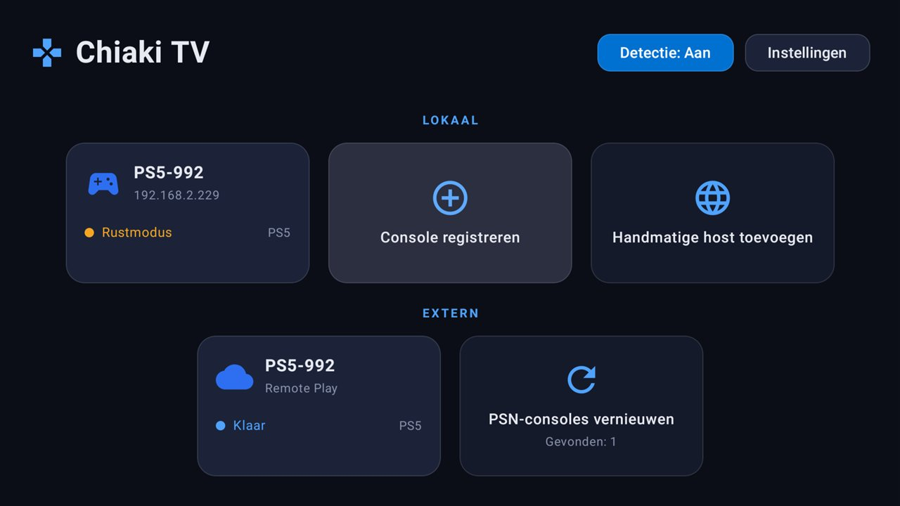
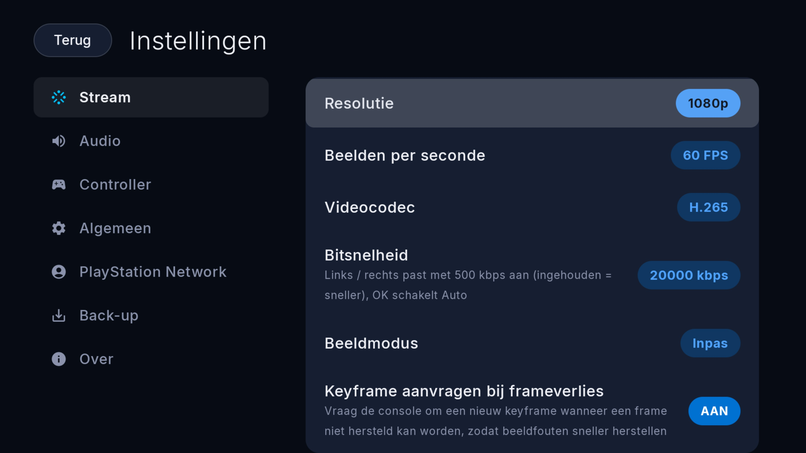
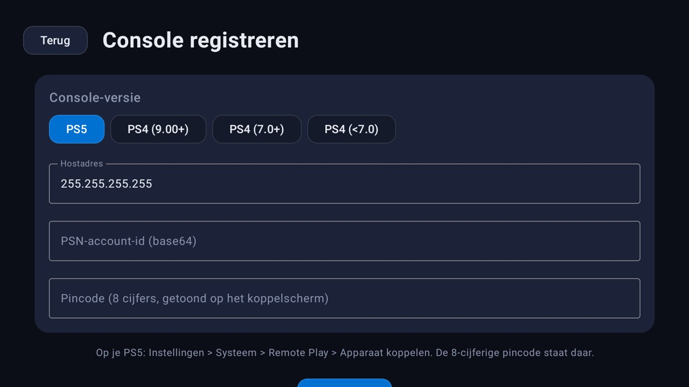
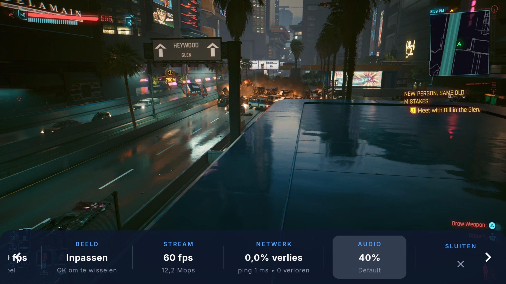
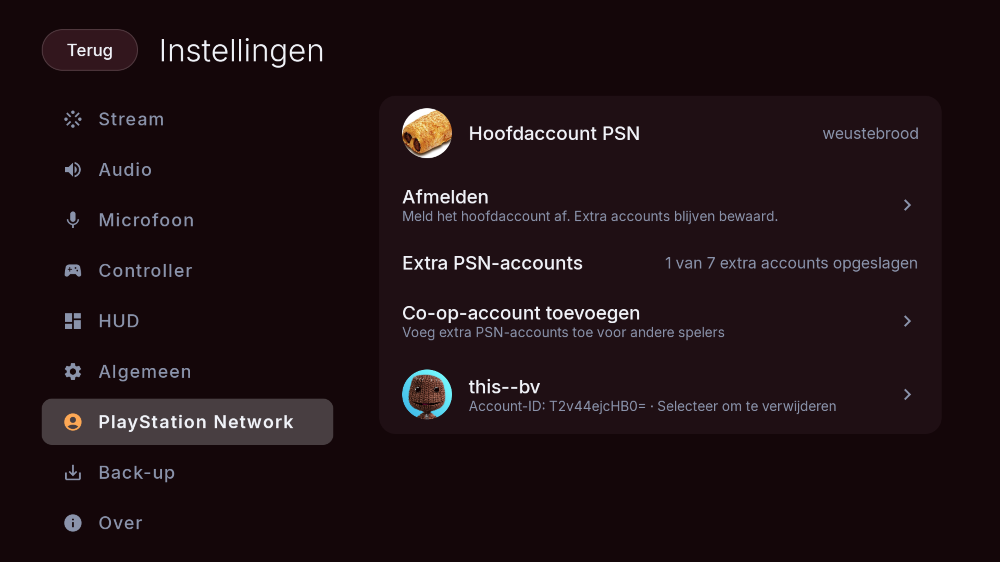
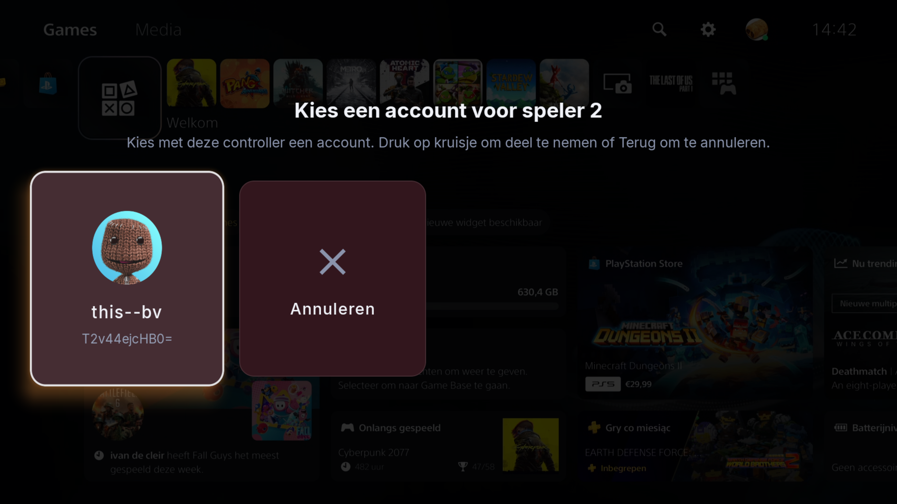

# Chiaki TV

Android TV port of [chiaki-ng](https://github.com/chiaki-ng/chiaki-ng) — free and open-source
PS4/PS5 Remote Play. Stream your PlayStation console to an Android TV device
(Google TV, Nvidia Shield, Xiaomi TV Box, ...) over your local network **or over the internet
via Remote Play over Internet (PSN)**.

The streaming core is chiaki-ng's battle-tested C library (Takion/RPCrypt protocol stack,
MediaCodec hardware video decoding, Oboe low-latency audio). The UI is a native
**Jetpack Compose for TV** app with a PlayStation-inspired look (Inter typeface, PS5-style
home with ambient glow and pill buttons, two-pane settings) and full D-pad/gamepad navigation.

Current version: **1.22.0-tv** (Android version code **31**).

## Features

- **Console discovery** — automatically finds PS4/PS5 consoles on the LAN
- **Console registration** — PIN-based pairing flow (8-digit PIN from the console);
  selecting an unregistered discovered console opens registration with its IP and
  console type (PS5/PS4) prefilled
- **Remote Play** — H.264 / H.265 / H.265 HDR, up to 1080p60, auto or manual bitrate (2000–50000 kbps),
  display modes Fit / Zoom / Stretch (*Settings → Stream → Display Mode*, also live on the HUD)
- **Fast artifact recovery** — when a frame can't be repaired from redundant packets, the console
  is immediately asked for a fresh keyframe instead of waiting for the next one
  (*Settings → Stream → Request Keyframe on Frame Loss*, on by default)
- **Session keep-alive** — leaving the app during a stream keeps the session connected (muted);
  returning restores video and audio on the live session without reconnecting, including on
  Shield TV when the video decoder must be recreated. The configured background timeout still applies
- **When Leaving Stream** — *Settings → General → When Leaving Stream* (Ask / Sleep Console /
  Do Nothing): one setting for what happens to the console when you disconnect (HUD ✕ chip or
  remote Back) *and* when you leave the app mid-stream — show the Sleep/Disconnect dialog,
  sleep the console automatically (backgrounding sleeps it after a minute away), or leave it running
- **Wake-on-connect** — selecting a rest-mode console wakes it and auto-connects once it comes online;
  wake and remote-connect progress shows as a modal dialog with a Cancel button (Back cancels too)
- **Auto-connect on startup** — pick a console in Settings; the app wakes and connects to it automatically on launch
- **PSN sign-in + Remote Play over Internet** — sign in to PlayStation Network from the TV
  (*Settings → PlayStation Network*: scan the QR code or enter the short code on any phone/PC);
  your PS5 consoles then appear in the **Remote** section and stream from anywhere over the
  internet (PSN holepunching). First connection to a console auto-registers it — no PIN needed
- **Google TV home channel** — registered consoles appear as programs on a "Chiaki TV" preview
  channel on the home row (with per-console PS5/PS4 artwork); selecting one wakes and connects.
  PSN-registered consoles additionally get **Remote Play via PSN** programs that start an
  internet session directly
- **Focus memory** — every menu (home, settings, logs, hosts, in-stream HUD) remembers exactly
  where you were when you left it
- **PS5-style focus** — the selected console card and the top-bar buttons smoothly scale up with
  a soft cyan glow, mirroring the console's own UI
- **Dutch & English UI** — follows the system language
- **Gamepad support** — full controller mapping incl. sticks, triggers, motion controls and rumble
- **PS5 local multiplayer** — additional gamepads can join the same Remote Play session using
  separate saved PSN accounts. Player 2 joining has been verified on a Shield TV and PS5;
  the game and console determine how many players can participate
- **PSN account management** — save up to **seven extra accounts in addition to the primary account**
  in *Settings → PlayStation Network*. View saved account IDs and remove extra accounts individually;
  removing one preserves the other accounts, and signing out of the primary account keeps the extras.
  PSN tokens are stored encrypted on the device and are excluded from settings exports
- **TV remote support** — D-pad and menu button act as controller input while streaming (toggleable)
- **Manual hosts** — add consoles by IP when discovery is not enough
- **Audio controls** — stream volume (applies live), output-device selection
  (HDMI, Bluetooth, USB, ...) with automatic fallback to the system default, and
  audio buffer size (Auto or 10–100 ms in 10 ms steps, like the Qt app)
- **Microphone** — stream your mic to the console for party chat / in-game voice
  (*Settings → Microphone*): enable (with permission prompt), start-unmuted, input-device
  picker (built-in, USB or Bluetooth headset mics), gain, platform echo cancellation /
  noise suppression / auto-gain, and opus encoder tuning (encoder **complexity** + audio
  **bandwidth** presets to trade CPU for voice quality). The mic is skipped automatically
  when the device has no real capture source (some TVs report a phantom mic that only
  records silence). The console receives the mic audio itself — not the headset as a
  device; game audio keeps playing on your normal output as usual. An **experimental
  live pitch shifter** (Sonic library) can transpose your voice ±12 semitones
  (*Settings → Microphone → Pitch Shift*), also toggleable live from the HUD
- **In-stream HUD** — press **L3 + R3** (configurable: Select + Start or L1+R1+L2+R2 via
  *Settings → HUD → HUD Shortcut*) while streaming to toggle an interactive bar with live
  FPS, measured bitrate, packet loss %, ping, lost frames, app CPU usage (% of total
  capacity + cores used / total cores) and the current video/audio config. Which chips appear and in what order is
  fully editable (*Settings → HUD → HUD Items*): **cross** toggles a chip on/off, **hold cross**
  (or **Menu**) enters move mode and **up/down** reorders; the **✕** chip is always shown and
  can only be reordered.
  Navigate the chips with the **D-pad** (gamepad D-pad *and* left stick are both understood):
  the **Audio** chip cycles the output device with **cross** and adjusts volume with **D-pad
   up/down**, the **Mic** chip toggles mic mute with **cross** and adjusts mic gain with **D-pad
   up/down**, the **Pitch** chip toggles the mic pitch shifter with **cross** and adjusts the
   semitone offset with **D-pad up/down**, the **Display** chip cycles Fit/Zoom/Stretch; the **✕**
   chip closes the stream per the *When Leaving Stream* setting. While the HUD is open only D-pad +
   cross are captured — every other button/stick still goes to the game. Back closes the HUD
- **Clean disconnect** — closing the stream (HUD ✕ or remote Back, per the *When Leaving Stream* setting)
   shows a "Disconnecting" spinner and returns to the main screen once the session has fully shut down
- **Settings** — PS5-style two-pane layout (category list on the left, options on the right):
  Stream, Audio, Microphone, Controller, HUD, General, PlayStation Network, Backup and About pages incl.
  resolution, FPS, codec, bitrate, audio, controller options, HUD options, verbose logging and
  session log viewer. Numeric values (volume, audio buffer, mic gain, pitch) adjust directly with
  **D-pad left/right** (accelerated on hold) and reset to their default on **cross**; the About page
  links to upstream chiaki-ng, this project and the license
- **Login PIN auto-entry** — store the console's Remote Play login PIN per console
  (*Registered consoles → console → Login PIN*) or as a global default
  (*Settings → General → Login PIN*); it is submitted automatically when the console asks,
  and the dialog only appears if no PIN is stored or the console rejected it
- **Backup** — export/import registered + manual hosts as JSON (compatible with chiaki-ng's format);
  import asks to **Replace** or **Merge** with existing consoles and reports failures instead of
  silently ignoring them

## Screenshots

| Home | Settings |
| --- | --- |
|  |  |

| Console registration | In-stream HUD |
| --- | --- |
|  |  |

| PSN accounts | Co-op account picker |
| --- | --- |
|  |  |

## Requirements

- Android TV 7.0+ (API 24), **arm64-v8a** and **armeabi-v7a** (Shield TV and other modern TV
  boxes on arm64; older 32-bit ARM boxes like the Mi Box 3 on armeabi-v7a)
- PS4 (system software 5.0+) or PS5 with Remote Play enabled
- A PSN **Account ID** (base64, 8 bytes) for registration — obtain it with the
  `psn-account-id.go` or `psn-account-id.py` script from
  [`external/chiaki-ng/scripts/`](external/chiaki-ng/scripts) (see
  [chiaki-ng's guide](https://github.com/chiaki-ng/chiaki-ng#obtaining-your-psn-accountid)).
  Signing in with PSN inside the app (*Settings → Sign in with PSN*) fetches it automatically.

## Getting started

1. Install the APK on your TV (`adb connect <tv-ip>:5555` then
   `adb install app/build/outputs/apk/release/app-release.apk` — or the debug APK from the same tree).
2. Enable Remote Play on the console (PS5: *Settings → System → Remote Play*; PS4: *Settings → Remote Play Connection Settings*).
3. Open Chiaki TV — discovered consoles appear as cards. Select one and enter the 8-digit
   pairing PIN shown on screen (or use *Register Console*).
4. Select the registered console to start streaming. A rest-mode console is woken automatically
   and the stream starts as soon as it comes online (Cancel with Back or the **Cancel** button).
5. **Remote Play over the internet (optional):**
   1. Enable Remote Play on the console and make sure it is linked to your PSN account.
   2. In Chiaki TV open *Settings → Sign in with PSN*. A QR code appears on the TV.
   3. Scan it with your phone (or open the same URL on a PC), sign in to PlayStation Network,
      then copy the full URL your browser lands on (a blank page) and paste it into the dialog
      on the TV — or just paste the authorization **code** alone (the `code=` value from that URL).
      The app exchanges the code and stores the tokens encrypted on the device.
   4. Your PS5 consoles appear in the **Remote** section of the home screen. Selecting one
      connects over the internet (the first connection auto-registers the console — no PIN
      needed; afterwards it behaves like a locally registered console).
      The "Chiaki TV" Google TV channel also gets **Remote Play via PSN** programs for them.
6. Optional: *Settings → General → Auto-connect on Startup* + pick a console — launching the app
   (or selecting its program on the "Chiaki TV" Google TV channel) then wakes and connects by itself.
7. While streaming, press **L3 + R3** on the controller to open the in-stream HUD
   (stats, live audio device/volume, and the **✕** chip that disconnects — and sleeps the console
   too if *When Leaving Stream* is set to Sleep Console).

> **Note (Shield TV):** the system intercepts the controller's **PS button** as HOME, so it
> cannot be forwarded to the console. The **Create/Share** button (which Android remaps to
> Back) is forwarded to the console as the PS button instead. The **touchpad click** is
> sent as a real touchpad click (not Create/Share).

### Adding multiplayer users (PS5)

1. Add each extra player's user profile to the PS5 and sign it in to that player's PSN account.
   Complete any console sign-in or profile passcode prompts first.
2. In Chiaki TV, open *Settings → PlayStation Network → Add co-op account* and sign in with
   that player's PSN account. Repeat for other players; up to seven extra accounts can be saved.
3. Connect the gamepads to the TV and start a PS5 stream. Press a button on an additional
   gamepad to open the account cards over the stream. Choose an available account with
   that controller's D-pad or left stick and press Cross to join; Back cancels. Accounts
   already in use are unavailable. A message confirms when the console accepts the player.
   PSN names and avatars are fetched when an account is added and shown in PSN settings for the primary and extra accounts. Cards reuse this cache, refreshing it through the Remote Play account-info and profile services. A standard account icon and saved account ID remain available if fetching fails.
4. Start a game that supports local multiplayer. Additional controllers send their own input;
   player 1 controls the stream HUD.

The seven saved extra accounts form an account pool, not a promise of eight simultaneous
players. The current protocol implementation has seven controller slots in total, including
player 1, and the console or game may impose a lower limit. Extra-player joins are PS5-only.

To remove a saved extra account, select its row in *Settings → PlayStation Network* and
confirm removal. This removes its saved credentials from the app, not its profile on the PS5.
Accounts are stored by account ID, so deleting one from the middle of the list does not change
the credentials of the remaining accounts.

## Building

All building happens in Docker — the Android NDK and aapt2 are x86_64-only, so on ARM hosts
the image runs under qemu emulation (slow but correct). Full details in [AGENTS.md](AGENTS.md).

```powershell
# one-time: fetch the chiaki-ng submodule (C core + JNI)
git submodule update --init external/chiaki-ng
git -C external/chiaki-ng submodule update --init third-party/nanopb third-party/jerasure third-party/gf-complete third-party/curl

# one-time: fetch the opus submodule (mic audio encoder)
git submodule update --init native/third-party/opus

# one-time: build the Linux build image
docker build --platform linux/amd64 -f docker/Dockerfile.build -t chiaki-tv-build-amd64 docker/

# build the APK (build.ps1 keeps a persistent container with the Gradle daemon and cache;
# full Kotlin/native rebuilds under emulation can take several minutes)
.\build.ps1

# Kotlin-only iteration: skip the CMake/NDK tasks (~25 s) when native/ and external/ are unchanged
.\build.ps1 -SkipNative

# build the release APK (signed with the repo keystore, optimized native libs)
.\build.ps1 assembleRelease
```

Output: `app/build/outputs/apk/debug/app-debug.apk` or `app/build/outputs/apk/release/app-release.apk`.
The release APK is signed with the repo's keystore, so it installs over a debug build without data loss.
Both ARM ABIs are included by default. For an ARM64-only build:

```powershell
.\build.ps1 "assembleRelease -Pabis=arm64-v8a"
```

Account-storage and controller-slot regression tests run in the same Docker environment:

```powershell
.\build.ps1 "testDebugUnitTest -Pabis=arm64-v8a"
docker exec -w /src chiaki-tv-build python3 native/tests/run_multislot_tests.py
```

The native tests check join/leave handling and feedback packet bytes against the local
Asobi reference. They simulate console replies; hardware testing is still needed for
console acceptance and game compatibility.

## Project layout

```text
app/                    Android TV app (Kotlin + Compose, namespace com.chiaking.tv)
external/chiaki-ng      git submodule — upstream chiaki-ng (C core, built via CMake)
native/                 CMake entry point + our copy of the JNI layer
                        (adds audio volume/device/buffer, mic opus sender via
                        native/third-party/opus, live mic pitch shift via
                        native/third-party/sonic, stream stats and surface keep-alive
                        on top of upstream)
native/overrides/       Local C-core overrides, including PS5 co-op and feedback routing
native/tests/           Native co-op lifecycle and wire-format regression tests
docker/                 Docker build image definition
docs/UPSTREAM_SYNC.md   How to integrate new upstream chiaki-ng commits
AGENTS.md               Build/architecture notes for AI agents and contributors
```

The C core comes from the submodule, with selected files replaced by local overrides
through `native/CMakeLists.txt`; the JNI layer is our own copy in
`native/jni/` that must be re-diffed on upstream bumps (see `docs/UPSTREAM_SYNC.md`).
The Kotlin layer is a manual port of upstream's Android app adapted for TV.

## Troubleshooting

- **No consoles discovered** — TV and console must be on the same L2 network (mDNS/UDP broadcast);
  check router AP-isolation settings, or add the console as a manual host.
- **Registration fails** — double-check the PSN Account ID (base64, decodes to 8 bytes) and that
  the PIN was entered within its validity window; enable *Verbose Logs* and check *Session Logs*.
- **Stutter / high latency** — prefer 5 GHz Wi-Fi or Ethernet; try H.265 and lower the bitrate.
- **D-pad does nothing in game** — enable *Settings → Controller → D-pad sends controller input*.
- **Extra player cannot join** — use a PS5, add a distinct extra PSN account in the app, and
  ensure that account has a signed-in profile on the console. Resolve any profile passcode
  prompts on the PS5, then press a button on the extra controller to retry. Check the game's
  local multiplayer support and the console's player limit. After a join timeout, reconnect
  the stream if the console has not released the pending request.

## License

Licensed under the same terms as chiaki-ng: **AGPL-3.0-only with OpenSSL link exception**
(`LicenseRef-AGPL-3.0-only-OpenSSL`). This project is not affiliated with Sony or PlayStation.
